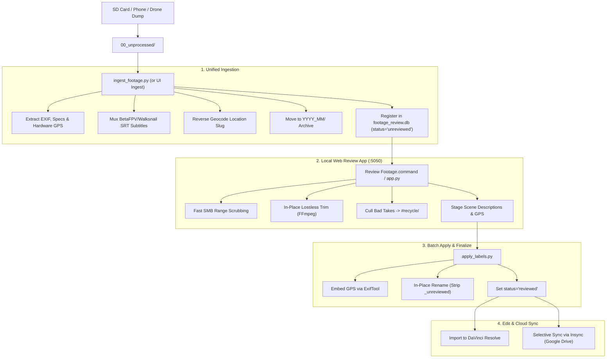
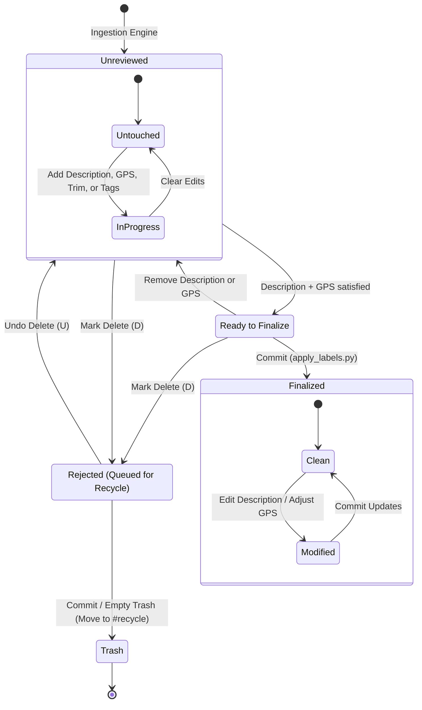

# Deepfield

> *Automated ingestion, SQLite cataloging, lossless trimming, and review pipeline for high-volume video and drone archives.*

**Deepfield** (`/Volumes/deepfield`) is a dedicated high-capacity storage volume, SQLite metadata catalog, and automated media pipeline designed to organize, triage, and archive large volumes of raw video, aerial drone flights, and photo assets.

Working with high-bitrate cameras, FPV quadcopters, action cameras, and phones quickly generates hundreds of gigabytes of unstructured files. Deepfield solves this through a unified workflow: single-step ingestion, automated EXIF/GPS reverse geocoding, flight telemetry muxing, a browser-based keyboard review application, and lossless in-place trimming before editing in DaVinci Resolve or archiving to the cloud.

---

## Storage & Volume Architecture

The volume is partitioned into standardized top-level directories to separate incoming media, project files, and finished deliverables:

| Directory | Purpose |
| :--- | :--- |
| `00_unprocessed/` | Temporary intake staging folder for SD card, drone, and phone dumps. |
| `01_raw_footage/` | Master chronological archive (`YYYY_MM/01_videos/` and `02_stills/`), SQLite database, and review tools. |
| `02_audio/` | Music tracks, sound effects libraries, and voiceover stems. |
| `03_other_assets/` | Motion graphics, channel branding, overlay assets, and logos. |
| `04_project_files/` | DaVinci Resolve project archives (`.drp`), timeline backups, and project databases. |
| `05_exports/` | Final master video exports and client deliverables. |
| `#recycle/` | Collision-protected quarantine for culled takes and fail-safe pre-trim backups. |
| `footage_review.db` | Master SQLite catalog tracking clip metadata, technical specs, and review states. |

---

## Standardized Naming Convention

All media files follow a strict naming scheme that encodes date, time, camera model, geocoded location, and a human-readable scene description:

```
YYYYMMDD_HHMMSS_CameraModel_Location_SceneName.ext
```

### Ingestion vs. Finalized Names

1. **Intake Staging**:
   ```
   20260420_123107_iPhone-11-Pro_Portland-OR_Scene-Name-Placeholder_unreviewed.mov
   ```
2. **Finalized & Reviewed**:
   ```
   20260420_123107_iPhone-11-Pro_South-Lowell-Street-Portland-Oregon_flowers-and-trees-at-house-in-neighborhood.mov
   ```

### Camera & Hardware Slugs

Hardware slugs are parsed automatically from EXIF metadata:
- **Lumix G95 (`G95D`)** / **Lumix G85 (`DMC-G85`)**: Primary mirrorless video rigs.
- **iPhone 15** / **iPhone 11 Pro**: Mobile capture and b-roll.
- **GoPro HERO8 (`GP8`)**: Action and timelapse cameras; matching `.thm` and `.lrv` sidecars are detected and renamed in lockstep.
- **BetaFPV Meteor75 Pro P1 (`Meteor75-Pro-P1`)**: Micro whoop drone with Walksnail Avatar HD digital VTX.
- **Viofo A229 Pro (`VFA229`)**: Multi-channel dashcam footage.

---

## The Ingestion & Review Pipeline



---

## Core Components & Scripts

### 1. Ingestion Engine (`ingest_footage.py`)

Scans incoming media from `00_unprocessed/`, standardizes filenames, and moves assets into chronological directories:
- **Batch Metadata Extraction**: Queries ExifTool once across candidate files for capture timestamps, duration, resolution, frame rate, codecs, and camera metadata.
- **Automated Reverse Geocoding**: Resolves hardware GPS coordinates into standardized location slugs (`Portland-OR`, `Sol-Duc-WA`) using `geopy` (Nominatim) with Open Location Code (Plus Codes) fallback.
- **FPV Telemetry Softsub Muxing**: Detects Walksnail Avatar HD VTX identifiers in video comments. Because micro-drones lack real-time clocks, the script synchronizes timestamps from file creation times and uses FFmpeg to losslessly mux companion `.srt` telemetry logs into `.mp4` softsubs (`mov_text`).
- **Archive Migration**: Organizes files into `01_raw_footage/YYYY_MM/01_videos/` or `02_stills/` and logs each item in SQLite under a unique ingestion `batch_id`.

### 2. Local Web Review & Culling App (`review_app/app.py`)

A lightweight local Flask review tool launched via double-clicking **`Review Footage.command`** in Finder (or running on `http://localhost:5050`):
- **Network-Optimized Video Streaming**: Supports HTTP byte-range requests for lag-free scrubbing over SMB network storage.
- **FPV Telemetry HUD Toggle**: Toggles live flight telemetry subtitles (voltage, current, RSSI, satellite lock) directly over video playback.
- **Lossless In-Place Trimming**: Sets In (`I`) and Out (`O`) cut points to cut pre-roll, landing idle, or dead takes using `ffmpeg -c copy`. Trimming operates safely through `/tmp` with automatic `#recycle` backups.
- **Fail-Safe Culling**: Moves rejected clips into `/Volumes/deepfield/#recycle` with collision protection and instant zero-cost undelete (`U`).
- **Voice-to-Text Dictation**: Uses the browser's Web Speech API (`SpeechRecognition`) for hands-free description entry. Real-time interim transcripts stream directly into the description box, continuously filter the autocomplete catalog, and strip trailing punctuation on pause for clean filename slugs.
- **Keyboard Review Shortcuts**:

| Key | Action |
| :--- | :--- |
| `Space` | Play / Pause video |
| `J` / `L` | Seek backward / forward 5 seconds |
| `K` | Pause |
| `I` / `[` | Set In-point at current playhead |
| `O` / `]` | Set Out-point at current playhead |
| `T` | Execute in-place lossless trim |
| `C` | Toggle telemetry closed captions / OSD |
| `Option+D` / `Alt+D` | Toggle voice-to-text dictation (`🎙️`) |
| `Enter` | Save description to staging queue (and apply trim if points marked) & advance |
| `S` | Skip current clip (moves to back of review queue) |
| `D` / `Backspace` | Move rejected clip to `/Volumes/deepfield/#recycle` |
| `→` / `N` | Next clip in queue |
| `←` / `P` | Previous clip in queue |

### 3. Batch Finalizer & Commit Engine (`apply_labels.py`)

Executes deferred review actions staged in the SQLite database:
- **Lossless Video Trimming**: Cuts files in-place with pre-trim backup verification and automatic retry.
- **EXIF Geotagging**: Injects confirmed GPS coordinates into photo EXIF headers and QuickTime video atoms via ExifTool.
- **In-Place Slug Renaming**: Converts approved scene descriptions into clean slugs, strips `_unreviewed`, and updates companion sidecars (`.thm`, `.lrv`).
- **Catalog Finalization**: Transitions record status to `reviewed` and stamps `reviewed_at`.
- **Dry-Run Mode**: Supports `--dry-run` to preview all file operations before modifying disks.

### 4. Supporting Utilities

- **`sync_live_photos.py`**: Identifies Apple Live Photo pairs (matching HEIC stills and MOV companion clips), synchronizes their metadata bidirectionally, and ensures live photo pairs are renamed together.
- **`backfill_catalog.py`**: Crawls historical monthly folders (`2026_*`) and catalogs existing library media into `footage_review.db`.
- **`extract_all_gps.py`**: Multi-threaded batch scanner that extracts hardware GPS coordinates from cataloged media files lacking location tags.
- **`add_gitkeep.py`**: Traverses project folders and generates `.gitkeep` files in empty directories to preserve storage hierarchy in Git while ignoring media binaries.

---

## Media State Machine & Lifecycle

Every media item registered in `footage_review.db` follows an explicit review lifecycle:



### Integrity Guardrails

1. **No Incomplete Transitions**: Clips missing a scene description or location are never transitioned to `reviewed`. Committing trims or GPS on an un-described clip writes the changes but keeps the file in `unreviewed` so it remains visible in the review backlog.
2. **Decoupled Rejections**: Marking a file as rejected stages the deletion in the database without moving the file immediately, allowing instant undo. Files are only physically moved to `#recycle/` upon an explicit commit action.
3. **Re-Review Capability**: Finalized clips can be reopened, re-tagged, or trimmed at any time; changes stage as `modified` without resetting the archive date.

---

## Storage & Archival Strategy

Raw 4K video rapidly exhausts local storage. Deepfield employs a tiered archival model:

1. **Google Drive Cloud Master**: The complete organized library is mirrored to Google Drive as the primary master repository.
2. **Selective Local Sync via Insync**: Rather than mirroring terabytes locally, **Insync** selectively synchronizes only active project folders and current monthly footage to local NVMe working drives.
3. **Pre-Archive Review Policy**: Before files sync to the cloud or enter DaVinci Resolve, all clips must pass through the review pipeline to delete aborted takes, trim dead head/tail footage, and keep storage utilization lean.

---

## Tech Stack & Tooling

- **Database**: SQLite 3 with Write-Ahead Logging (`WAL` mode) and multi-threaded caching.
- **Backend & Review Server**: Python 3.8+ / Flask / HTTP Byte-Range Streaming.
- **Metadata & Geocoding**: ExifTool (`exiftool-vendored` equivalent via subprocess), `geopy` (OpenStreetMap Nominatim), and `openlocationcode`.
- **Media Engine**: FFmpeg (stream copy trimming, telemetry muxing, frame extraction).
- **Speech Engine**: Web Speech API (`webkitSpeechRecognition`) for real-time browser voice dictation.
- **Launcher**: macOS shell script (`Review Footage.command`).

---

## Interconnected Notes

- [[projects/vlog/filming-gear|Filming Gear]] — Cameras (Lumix G95, Lumix G85, iPhone 15, GoPro HERO8) that feed footage into Deepfield.
- [[projects/fpv/gear-and-builds|FPV Gear and Builds]] — Micro quad builds (Meteor75 Pro) and Walksnail Avatar HD telemetry integration.
- [[projects/software/garmin-camcmd|CamCommand]] — Garmin BLE remote application for Lumix cameras and 1 Hz GPS geotagging.
- [[projects/software/qr8|QR8]] — Distraction-free video curation and focused practice player.
